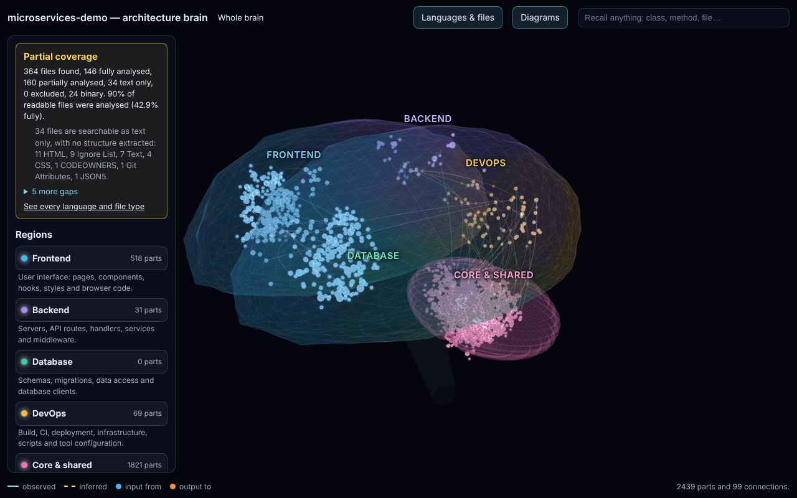
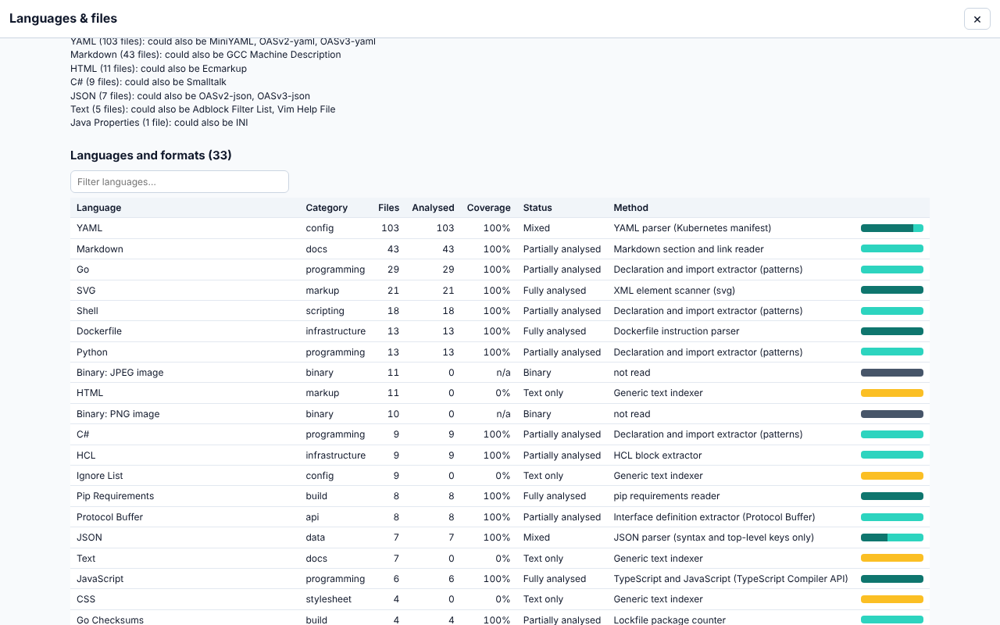
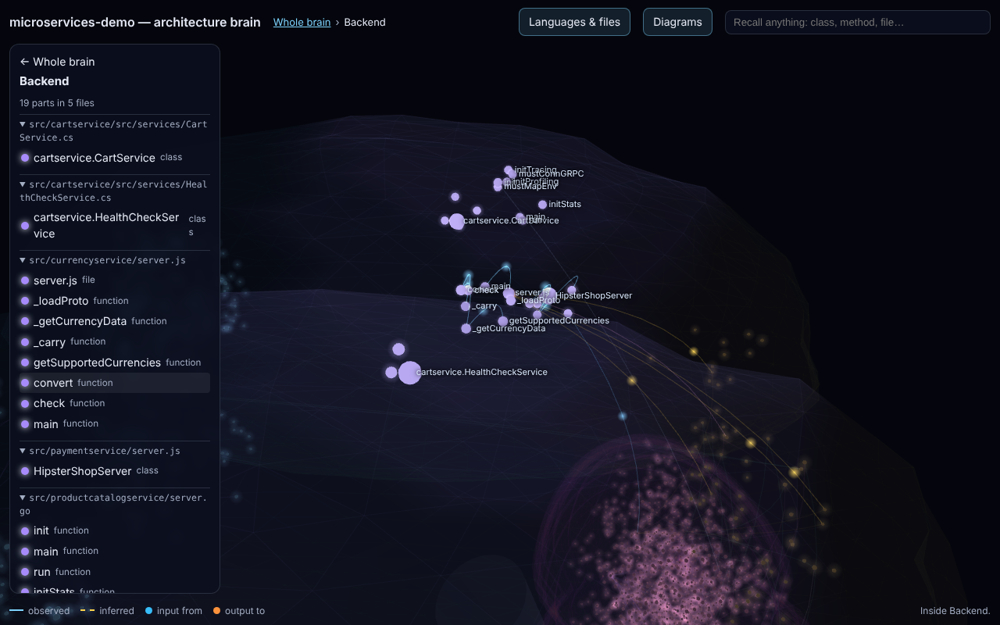

# ArchLens

**Architecture Intelligence & Repository Engineering Skill** (Nexora)

ArchLens is a Claude skill that helps Claude understand, map, explain, troubleshoot and safely change a software repository. Every claim it makes is tagged **observed** (read in the code, cited to `path:line`), **inferred** (reasoned from what was read, with the reasoning) or **unknown** (not checked). It can also draw an interactive 3D **architecture brain** of a repository as one HTML file.



## What you can ask

| Ask                                                           | What you get                                                                                                       |
| ------------------------------------------------------------- | ------------------------------------------------------------------------------------------------------------------ |
| "How does this repository fit together?"                      | A map of entry points, modules, data stores and integrations, each with its evidence                               |
| "Trace what happens when a user logs in"                      | The request path, file by file, with the calls between them                                                        |
| "What breaks if I change the `orders` table?"                 | The readers and writers of the table, the code that depends on them, and the risk                                  |
| "Why does checkout fail with a 500?"                          | An investigation: hypotheses, the evidence for and against each, and a proposed fix                                |
| "Make an architecture brain of https://github.com/owner/repo" | One HTML file with the 3D brain, database tables, ER, schema and class diagrams, and a Languages & files inventory |
| "Change X safely"                                             | A change plan, the edit, and the checks that prove it, following the safe-change protocol                          |

## Install

You need [Claude Code](https://code.claude.com) or a claude.ai plan with skills, and Node.js 22 or later for the brain and inventory scripts. The skill format follows the Claude Code skills docs (https://code.claude.com/docs/en/skills, checked 2026-11-03; research R11).

**Claude Code, every project:**

```bash
git clone https://github.com/amitkumarsingh1697/NEXORA.git nexora
mkdir -p ~/.claude/skills
cp -r nexora/skills/archlens ~/.claude/skills/archlens
```

**Claude Code, one project:** copy the folder to `<project>/.claude/skills/archlens/` instead.

**claude.ai:** zip the `archlens` folder (or use the release zip) and upload it under **Settings → Capabilities → Skills**. The frontmatter uses only `name`, `description` and `allowed-tools`, the fields the docs list as accepted outside Claude Code.

Check the install:

```bash
node ~/.claude/skills/archlens/scripts/check.mjs
# ✓ archlens: name, description, allowed-tools; 71 lines; 8 files linked cleanly
```

## Use

Start Claude Code in (or next to) the repository and either:

- run `/archlens <question or path>`, for example `/archlens trace the login flow`, or
- just ask an architecture question; Claude loads the skill when the question matches its description.

ArchLens picks a playbook (Map, Trace, Impact, Assess, Investigate, Change or Onboard), reads the code, and answers in the formats in [`references/report-templates.md`](references/report-templates.md). It never edits code unless you ask for a change, and then it follows [`references/safe-change-protocol.md`](references/safe-change-protocol.md).

## Architecture brain, step by step

Ask: **"Make an architecture brain of https://github.com/owner/repo"**. Asking is your permission for ArchLens to clone the repository into a temporary folder and run `node`; it never touches your own files. It then:

1. **Clones** the repository (`git clone --depth 1`, `https://` links only).
2. **Builds the model.**
   - With a Nexora checkout available, it runs CodeAtlas, which analyses TypeScript and JavaScript with the compiler, about 80 other languages with declaration patterns, and configuration, build, CI, container, infrastructure and API files with format readers:

     ```bash
     pnpm --filter @nexora/codeatlas-service cli brain /abs/path/to/repo --out repo-brain.html
     ```

   - Without CodeAtlas, it reads the code itself and writes `brain-model.json` in the format in [`references/brain-model.md`](references/brain-model.md).
3. **Counts every file** with the shared language registry, so the brain says what it does not cover:

   ```bash
   node scripts/inventory.mjs /abs/path/to/repo --model brain-model.json
   ```

4. **Checks** that every observed link has a file and line, that columns match the schema, and that nothing secret is included.
5. **Renders** the page: `node scripts/render-brain.mjs brain-model.json repo-brain.html`.
6. **Hands over** the file with the coverage sentence word for word and every gap.

Open the HTML file in any browser; it works offline. Click a lobe (Frontend, Backend, Database, DevOps, Core & shared) to go inside, click a class, method or table for its inputs, outputs, columns and links, use **Diagrams** for ER, schema and class diagrams (downloadable as SVG), and **Languages & files** for the inventory.

| Languages & files in the brain                                                              | Inside a lobe                                                                   |
| ------------------------------------------------------------------------------------------- | ------------------------------------------------------------------------------- |
|  |  |

The screenshots show the brain ArchLens produces through CodeAtlas (step 2) for [GoogleCloudPlatform/microservices-demo](https://github.com/GoogleCloudPlatform/microservices-demo) at commit `c7cb6d5`, a Go, C#, Python, Java and Node.js application. Most of its Go services land in Core & shared because their paths and imports carry no frontend or backend signal; lobe placement is an inference, and the brain says so.

## The inventory script

`scripts/inventory.mjs` lists every file in a repository (`git ls-files`, or a folder walk), identifies its language and file type, and gives it one of seven statuses: fully analysed, partially analysed, text only, recognised but not readable, failed, excluded or binary. It needs only Node.js.

```text
$ node scripts/inventory.mjs ../microservices-demo
git ls-files; registry: GitHub Linguist v9.7.0 data plus Nexora overlays.
364 files found, 0 fully analysed, 0 partially analysed, 340 text only, 0 excluded, 24 binary. 0% of readable files were analysed (0% fully).
Languages and formats (files, analysed, status):
  YAML                               103       0  text
  Markdown                            43       0  text
  Go                                  29       0  text
  …
```

Without a model every readable file is "text only": listed and identified, not analysed. With `--model brain-model.json`, the files the model cites count as read ("partially analysed", because they were read by hand and not checked by a compiler), and the counts are written into the model's `coverage.inventory`. With `--read paths.txt`, the listed files count as read too, and `--out inventory.json` writes every file's record. Nothing ArchLens reports is ever "fully analysed"; only CodeAtlas's parsers can say that.

## Contents

```
skills/archlens/
├── SKILL.md                         entry point (frontmatter + workflow)
├── references/
│   ├── evidence-model.md            the three labels and edge cases
│   ├── playbooks.md                 Map, Trace, Impact, Assess, Investigate, Change, Onboard
│   ├── risk-heuristics.md           risk signals with evidence and limitations
│   ├── report-templates.md          output formats
│   ├── safe-change-protocol.md      how to modify code safely
│   ├── codeatlas-integration.md     using a CodeAtlas index as evidence
│   └── brain-model.md               JSON format of the 3D architecture brain
├── assets/brain-template.html       the 3D brain page (generated by packages/brain)
└── scripts/
    ├── render-brain.mjs             model JSON → one self-contained brain HTML file
    ├── inventory.mjs                every file with its language, type and status (generated by packages/languages)
    └── check.mjs                    structural validation (run with node)
```

`assets/brain-template.html`, `scripts/render-brain.mjs` and `scripts/inventory.mjs` are generated (`pnpm --filter @nexora/brain build`, `pnpm --filter @nexora/languages build`); tests keep them identical to their sources.

## Validate

```bash
node skills/archlens/scripts/check.mjs
```

It checks that the frontmatter is on the first line with `name` and `description` and only portable fields, that `description` is within 1,536 characters, that `SKILL.md` is under 500 lines, that every linked reference exists, and that the brain template, renderer and inventory script are present.

## Status

The skill passes its structure check, and its scripts (render, inventory, the CodeAtlas brain path) have been run against Keycloak, Kubernetes and 21 other public repositories (see the [validation report](../../documentation/reports/LANGUAGE_COVERAGE_VALIDATION.md)). The conversational playbooks have not been scored in a recorded live Claude Code session in this workspace.
